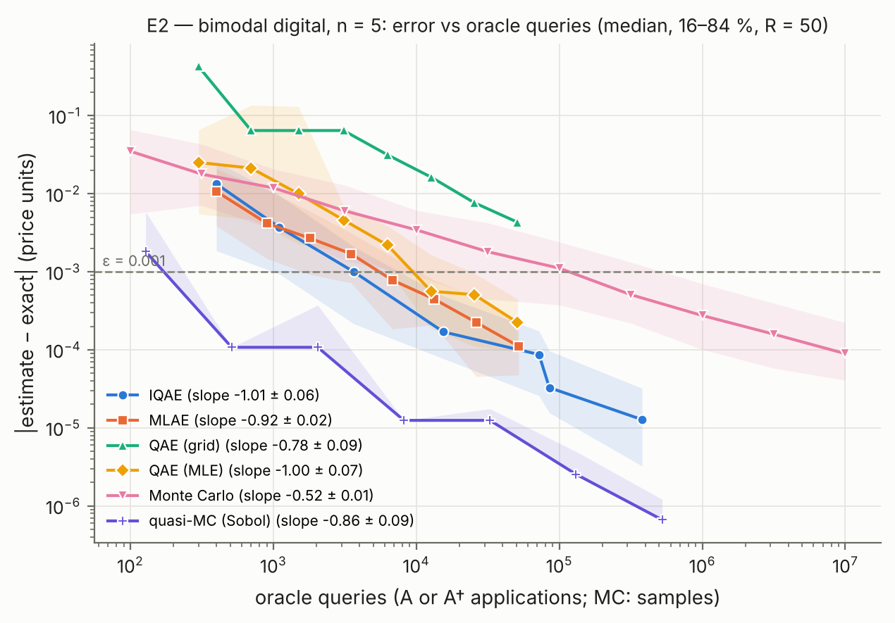

# qae-options

**Option pricing with quantum amplitude estimation.** QAE, IQAE and MLAE are compared with Monte
Carlo and quasi-Monte Carlo on a bimodal price distribution with a digital payoff. The study is
simulator-first and written in Python with Qiskit.

| Document | Contents |
|---|---|
| [REPORT.md](REPORT.md) | Results and conclusions (E1–E5) |
| [SPEC.md](SPEC.md) | Design, definitions, experiments |
| [demo/DEMO.md](demo/DEMO.md) | Live-demo run sheet for the presentation |

> The repository used to hold two projects (this one and `vqe-lih`) plus a shared package.
> That layout is kept on the [`archive/monorepo`](../../tree/archive/monorepo) branch.

## Headline result

At a price error of ε = 10⁻³, **IQAE needs ≈ 3,700 oracle queries and Monte Carlo ≈ 117,000
samples** (1/N vs 1/√N, measured). Canonical QPE-based QAE needs 6 more qubits and 38× the
depth. Two caveats are also measured: **quasi-Monte Carlo needs only ≈ 170 samples**, and
**on a realistic IBM noise model no quantum estimator reaches ε**.



## Quickstart

Everything goes through [uv](https://docs.astral.sh/uv/) (Python 3.12 is installed automatically).

```bash
curl -LsSf https://astral.sh/uv/install.sh | sh   # install uv (macOS / Linux)
uv sync                                            # create .venv from uv.lock
uv run qae-demo                                    # live demo, ~10 s of compute, paused per step
uv run pytest -m "not slow"                        # fast tests (~30 s)
```

On Windows, install uv with `powershell -c "irm https://astral.sh/uv/install.ps1 | iex"`; every
`uv run` command works the same (`run_all.sh` needs a POSIX shell).

### Demo

```bash
uv run qae-demo                 # 7 steps; Enter advances, figures open in the system viewer
uv run qae-demo --list          # list the steps
uv run qae-demo --step 4        # start at step 4 (the IQAE vs Monte Carlo race)
uv run qae-demo --quick         # smaller sweeps
uv run qae-demo --no-pause --no-open   # run straight through (used by CI)
```

### Experiments

| Experiment | Config | Question |
|---|---|---|
| `e1` | `e1_validate.toml` | Correct prices? Lognormal call/digital vs Black-Scholes; barrier (stretch) |
| `e2` | `e2_convergence.toml` | Error vs oracle queries: QAE, IQAE, MLAE, MC, QMC |
| `e3` | `e3_resources.toml` | Qubits, depth, 2q gates at ε = 10⁻³; fills in the claim |
| `e4` | `e4_noise.toml` | Noise frontier on a FakeSherbrooke noise model |
| `e5` | `e5_loading.toml` | Cost of loading the distribution vs n |

```bash
uv run qae-options e2 --config configs/e2_convergence.toml   # one experiment
./run_all.sh                                                 # all of them, ~1.5 h on 4 cores
```

Each run writes `results/raw/<name>.json` (gitignored, with config, seed, git SHA, `uv.lock`
hash and versions), `results/summary/<name>*.csv|json` and `results/figures/<name>*.{png,pdf}`.
Finished jobs are checkpointed in `results/raw/<name>.parts/`; delete it to force a recompute.

## Layout

```text
src/qae_options/   distributions (grids, loader) · payoffs (A operators) · reference (closed forms)
                   classical (MC, QMC) · estimators (QAE / IQAE / MLAE + query counting)
                   sampling (seeded exact SamplerV2) · resources · experiments · cli · demo
src/qcc_common/    simulator backends (Aer, scaled fake-IBM noise) · circuit metrics
                   experiment records · plotting style · parallel_map
configs/           one TOML per experiment
results/           summary/ (CSV, JSON) and figures/ (PNG, PDF) committed; raw/ gitignored
tests/             pytest; `-m slow` runs the end-to-end smoke test
demo/              DEMO.md run sheet; out/ holds the demo's figures (gitignored)
```

## Resolved versions

From `uv.lock` (Python 3.12): qiskit 2.5.2, qiskit-aer 0.17.2, qiskit-algorithms 0.4.0,
qiskit-ibm-runtime 0.50.0, numpy 2.5.3, scipy 1.18.1. Upgrade one package with
`uv lock --upgrade-package <pkg>` and rerun the tests before committing the lockfile.
